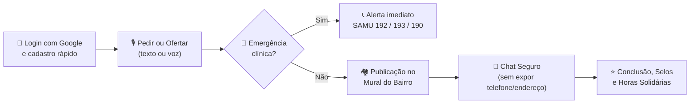
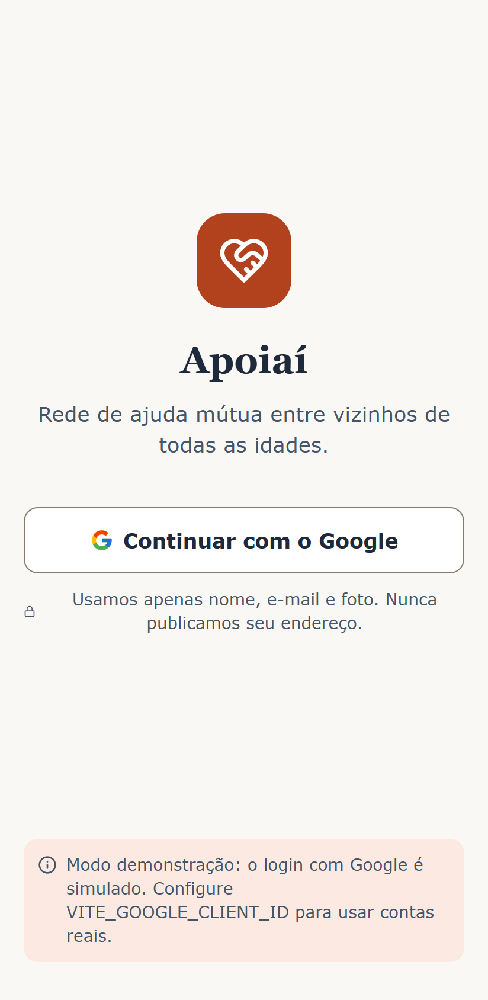
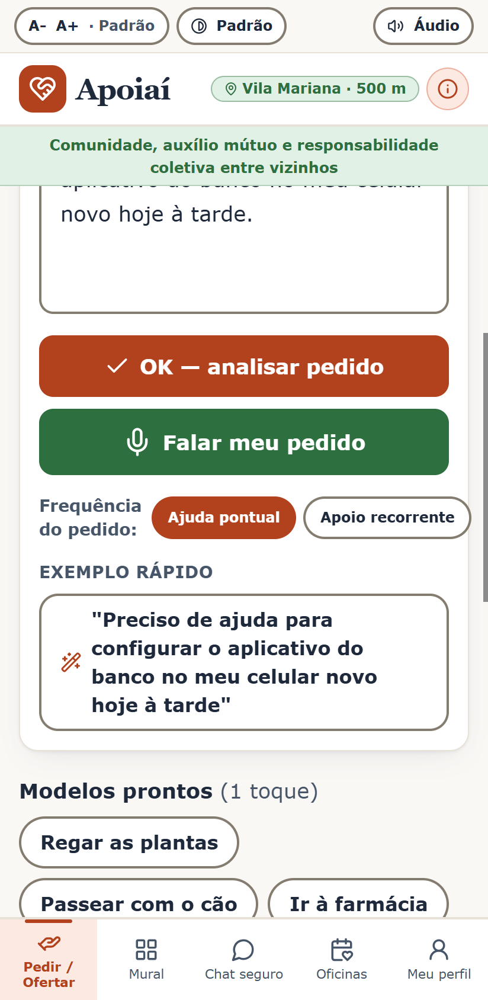
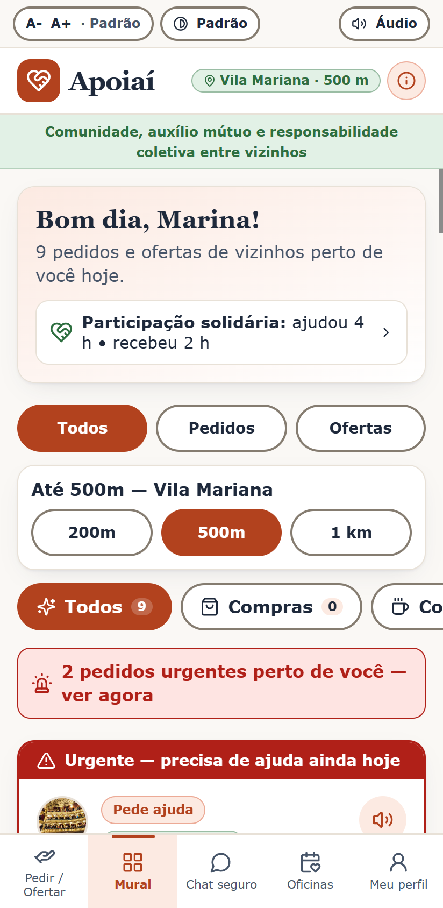
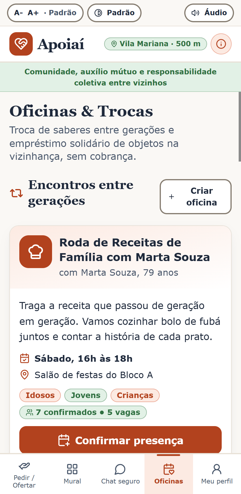
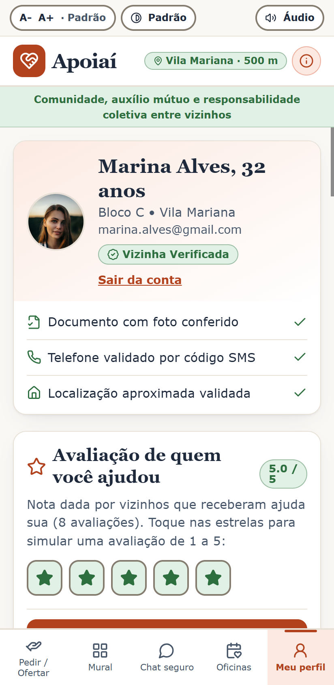

# 🤝 Apoiaí — Rede Intergeracional de Ajuda Mútua na Vizinhança

> **Comunidade, auxílio mútuo e responsabilidade coletiva entre vizinhos — sem transações financeiras.**


> 🌐 **Versão online (em breve):** em breve o Apoiaí será publicado em um domínio próprio para que qualquer pessoa possa testar diretamente pelo navegador, sem precisar instalar nada. Enquanto isso, siga as [instruções de execução local](#-como-executar-o-projeto).

---

## 📌 Índice

- [O Problema](#-o-problema)
- [A Solução Proposta](#-a-solução-proposta)
- [Como Funciona (Fluxo)](#-como-funciona-fluxo)
- [Capturas de Tela](#-capturas-de-tela)
- [Exemplos Práticos de Uso](#-exemplos-práticos-de-uso)
- [Como Executar o Projeto](#-como-executar-o-projeto)
- [Stack e Estrutura do Projeto](#-stack-e-estrutura-do-projeto)
- [Escopo do Protótipo](#-escopo-do-protótipo)

---

## 🧩 O Problema

Nas grandes cidades brasileiras, vivemos cada vez mais próximos fisicamente — nos mesmos prédios, condomínios e quarteirões —, mas cada vez mais desconectados socialmente. Esse distanciamento atinge com força especial pessoas idosas e moradores que vivem sozinhos, transformando a **solidão** e o **isolamento social** em um grave problema de saúde pública.

| Indicador de Referência | Impacto |
| :--- | :--- |
| **+26%** | Aumento no risco de mortalidade associado à solidão |
| **+29%** | Aumento no risco de mortalidade associado ao isolamento social |
| **+32%** | Aumento no risco de mortalidade em quem mora sozinho |
| **16,8% / 31,7%** | Idosos brasileiros que relatam sentir solidão *sempre* (16,8%) ou *algumas vezes* (31,7%) — *ELSI-Brasil* |

No dia a dia, esse cenário se traduz em barreiras concretas:

- **Pequenas tarefas viram grandes obstáculos:** configurar um aplicativo bancário sem medo de golpes, buscar um remédio na farmácia, trocar uma lâmpada queimada ou carregar sacolas do mercado podem ser desafios difíceis para quem tem mobilidade reduzida ou pouca familiaridade digital.
- **Falta de canais confiáveis na vizinhança:** vizinhos dispostos a ajudar muitas vezes não sabem quem precisa de apoio a poucos metros de distância, e grupos genéricos de mensagens não oferecem organização, privacidade nem verificação de confiança.
- **Mercantilização do cuidado:** aplicativos tradicionais cobram por cada favor ou serviço, excluindo quem não pode pagar e impedindo a criação de vínculos genuínos entre gerações.
- **Exclusão digital por falta de acessibilidade:** fontes pequenas, baixo contraste e fluxos complexos afastam justamente o público idoso das soluções digitais.

---

## 💡 A Solução Proposta

O **Apoiaí** é uma rede hiperlocal de ajuda mútua e convivência intergeracional desenhada para condomínios e vizinhanças próximas (raio de **200 m a 1 km**), alinhada aos princípios da **Política Nacional de Cuidados (Lei nº 15.069/2024)**.

Em vez de dinheiro, o Apoiaí promove **reciprocidade, reconhecimento comunitário e encontros presenciais**:

- **🔐 Entrada Simples com Google:** autenticação híbrida com Google (modo real via *Google Identity Services* ou modo demonstração simulado), seguida de um cadastro curto com bloco, bairro e **data de nascimento** (o sistema calcula a idade automaticamente e não expõe a data aos vizinhos).
- **🎙️ Pedidos e Ofertas com Triagem Inteligente:** o morador escreve ou **fala** o que precisa (ou pode oferecer). O sistema classifica automaticamente a **categoria**, o **nível de urgência**, a **frequência** (pontual ou recorrente) e a **estimativa de horas solidárias**.
- **🚨 Detecção de Emergências de Saúde:** ao identificar sinais de risco clínico (como *"dor no peito"* ou *"falta de ar"*), o aplicativo exibe imediatamente um alerta orientando a ligar para **SAMU 192**, **Bombeiros 193** ou **Polícia 190**, deixando claro que o Apoiaí não substitui atendimento médico.
- **🏘️ Mural da Vizinhança e Rede de Confiança:** pedidos e ofertas filtráveis por distância, tipo e categoria. Cada perfil exibe quantos vizinhos já o validaram e seus **selos de confiança** (*Pontual*, *Paciência Digital*, *Mão na Roda*, *Coração de Vizinho*, *Cuidador de Confiança* e *Gentil*).
- **💬 Chat Seguro com Privacidade:** combina horário e local sem expor telefone ou endereço exato (números de telefone são mascarados automaticamente). Incentiva encontros em áreas comuns e oferece acionamento rápido de contato de confiança e emergência.
- **🛠️ Oficinas Intergeracionais e Banco de Objetos:** agenda de encontros presenciais entre gerações (ex.: *Roda de Receitas*, *Oficina de Celular sem Medo*, *Horta Comunitária*) e empréstimo solidário de itens pouco usados (furadeira, escada, cadeira de rodas, andador, carrinho de feira).
- **⏱️ Banco de Horas Solidárias e Comércio Local:** cada ajuda concluída registra horas solidárias, gera agradecimentos públicos no mural e desbloqueia benefícios em parceiros do bairro (padaria, farmácia, hortifruti).
- **♿ Acessibilidade Integrada:** barra fixa no topo com ajuste de tamanho da fonte (`A-` / `A+`), modo de alto contraste, leitura em voz alta (*Text-to-Speech* em português) e entrada por voz.

---

## 🔄 Como Funciona (Fluxo)



---

## 📱 Capturas de Tela

O Apoiaí foi projetado com abordagem *mobile-first*, botões amplos e leitura confortável para todas as idades:

<table>
  <tr>
    <td align="center">
      <br />
      <b>1. Login com Google</b><br />
      <sub>Entrada simples (real ou simulada)</sub>
    </td>
    <td align="center">
      <br />
      <b>2. Pedir / Ofertar</b><br />
      <sub>Triagem automática por texto ou voz</sub>
    </td>
    <td align="center">
      <br />
      <b>3. Mural do Bairro</b><br />
      <sub>Pedidos próximos, filtros e selos</sub>
    </td>
  </tr>
  <tr>
    <td align="center">
      <br />
      <b>4. Oficinas e Trocas</b><br />
      <sub>Encontros intergeracionais e empréstimos</sub>
    </td>
    <td align="center">
      <br />
      <b>5. Perfil e Reciprocidade</b><br />
      <sub>Horas solidárias, selos e parceiros</sub>
    </td>
    <td align="center">
      <b>♿ Barra de Acessibilidade</b><br /><br />
      <sub>Presente em todas as telas:<br/>• Fonte ampliável (<code>A-</code> / <code>A+</code>)<br/>• Alto contraste<br/>• Leitura em voz alta (TTS)</sub>
    </td>
  </tr>
</table>

---

## 🧪 Exemplos Práticos de Uso

Para entender o potencial do Apoiaí em poucos minutos, experimente estes fluxos no aplicativo:

### Exemplo 1 — Apoio Digital entre Gerações
1. Na aba **Pedir / Ofertar**, clique em um modelo pronto ou digite:
   > *"Preciso de ajuda para configurar o aplicativo do banco no meu celular novo hoje à tarde."*
2. Clique em **OK — analisar pedido**. O sistema identifica a categoria **Tecnologia**, urgência **Alta**, prazo **Hoje, à tarde** e estimativa de **30 min (0,5 h solidárias)**.
3. Clique em **Publicar no mural do bairro**. Em poucos segundos, um vizinho compatível responde no **Chat seguro** para combinar o encontro na área comum.
4. No chat, experimente enviar um número de telefone (ex.: `11 99999-8888`) para ver o mascaramento automático de dados sensíveis em ação.

### Exemplo 2 — Alerta de Emergência de Saúde
1. Na aba **Pedir / Ofertar**, digite:
   > *"Estou com dor no peito e falta de ar."*
2. Clique em **OK — analisar pedido**. Um card vermelho de alerta aparece no topo com botão direto para ligar para o **SAMU (192)**, evitando que situações críticas dependam de ajuda informal.

### Exemplo 3 — Convivência e Economia Solidária
1. Acesse a aba **Mural** e filtre por **Ofertas** ou por distância (**Até 200m** / **Até 500m** / **Até 1 km**). Toque em **Posso ajudar** em qualquer pedido (como o da Dona Helena ou do Sr. Antônio) para abrir o chat e concluir uma ajuda com avaliação e selo.
2. Acesse **Oficinas** para confirmar presença em encontros como a *Roda de Receitas de Família* ou solicitar um item no **Banco de Objetos** (como uma escada ou cadeira de rodas dobrável).
3. Acesse **Meu perfil** para ver seu banco de horas solidárias, quem validou sua conta, seu histórico e os descontos desbloqueados no comércio do bairro.

---

## 🚀 Como Executar o Projeto

### 🌐 Acesso Online (Em breve)
Em breve o aplicativo estará disponível em um domínio próprio para acesso direto pelo navegador do computador ou celular, sem necessidade de instalação.

### 💻 Execução Local

#### Pré-requisitos
- [Node.js](https://nodejs.org/) versão **18** ou superior (inclui `npm`).

#### Passo a passo

```bash
# 1. Clone o repositório
git clone <url-do-repositorio>
cd apoiai-hack-brasil-2026

# 2. Instale as dependências
npm install

# 3. Inicie o servidor de desenvolvimento
npm run dev
```

Após rodar `npm run dev`, abra no navegador:
- **No computador:** `http://localhost:5173/`
- **No celular (mesma rede Wi-Fi):** use o endereço `Network` exibido no terminal (ex.: `http://192.168.x.x:5173/`).

> 💡 **Dica:** no computador, o app já exibe uma barra lateral explicativa ao lado da prévia móvel, mas você também pode testar em tela cheia de celular usando o modo responsivo do navegador (`F12` → `Ctrl+Shift+M`).

#### 🔐 Opcional: Ativar Login Real com Google

Sem nenhuma configuração extra, o Apoiaí inicia em **modo demonstração** com um seletor de contas Google simulado. Para testar com contas Google reais:

1. Crie um **ID do cliente OAuth (Aplicativo da Web)** no [Google Cloud Console](https://console.cloud.google.com/apis/credentials) e adicione `http://localhost:5173` em *Origens JavaScript autorizadas*.
2. Copie o arquivo de exemplo e preencha o seu Client ID:
   ```bash
   cp .env.example .env.local
   ```
   ```env
   VITE_GOOGLE_CLIENT_ID=seu-client-id-aqui.apps.googleusercontent.com
   ```
3. Reinicie o servidor (`npm run dev`).

#### Scripts disponíveis

| Comando | Descrição |
| :--- | :--- |
| `npm run dev` | Inicia o servidor local com hot-reload (`vite --host`) |
| `npm run build` | Gera a versão otimizada de produção na pasta `dist/` |
| `npm run preview` | Serve localmente o build gerado em `dist/` |

---

## 🛠️ Stack e Estrutura do Projeto

- **Frontend:** React 18 + Vite 5
- **Estilização:** Tailwind CSS 3 (com variáveis CSS para alto contraste e escala tipográfica)
- **Ícones:** Lucide React
- **Acessibilidade e Voz:** Web Speech API (`speechSynthesis` para leitura em voz alta e `SpeechRecognition` para ditado por voz)

```text
apoiai-hack-brasil-2026/
├── docs/screenshots/      # Capturas de tela usadas neste README
├── public/                # Recursos estáticos (favicon)
├── src/
│   ├── components/        # A11yBar, BottomNav, RequestCard, TrustGraph, UI
│   ├── lib/               # auth.js, triage.js, useSpeech.js, format.js
│   ├── screens/           # Login, Pedir, Mural, ChatList, Chat, Oficinas, Perfil, Conclusao
│   ├── App.jsx            # Estado principal, navegação e fluxo de demonstração
│   ├── data.js            # Dados iniciais de demonstração, selos, oficinas e estatísticas
│   └── main.jsx           # Ponto de entrada e controle de sessão (AuthGate)
├── .env.example           # Modelo de variáveis de ambiente (Google Client ID)
└── package.json
```

---

## ℹ️ Escopo do Protótipo

Este repositório contém um **protótipo funcional de frontend** desenvolvido para o **Google Hack Brasil 2026**, sem servidor backend:

- **Dados de demonstração:** pedidos, vizinhos, oficinas e objetos iniciais são carregados em memória a partir de `src/data.js` (ao recarregar a página, novos pedidos/mensagens voltam ao estado inicial).
- **Persistência local:** apenas a sessão de login, os perfis cadastrados e as preferências de acessibilidade são salvos no `localStorage` do navegador.
- **Triagem e respostas:** a triagem semântica opera localmente por regras e palavras-chave (preparada para integração futura com a API do **Google Gemini**), e as respostas dos vizinhos no chat são simuladas contextualmente para permitir testar todo o ciclo de ajuda de ponta a ponta.
